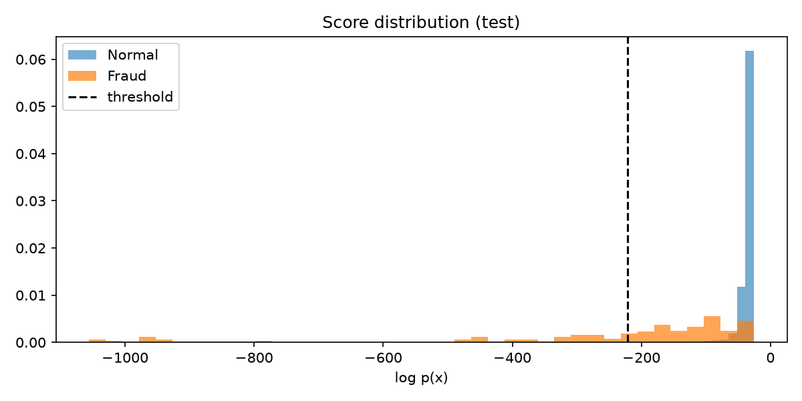
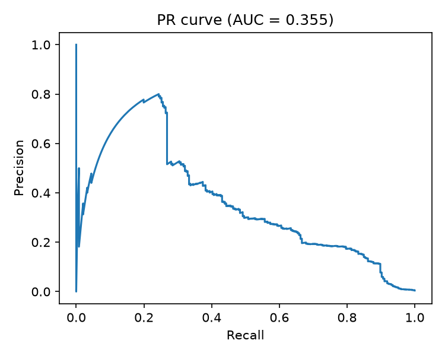

# Credit Card Fraud Detection with Gaussian Anomaly Detection

Anomaly detection project that flags fraudulent credit card transactions by modeling what a **normal** transaction looks like, using a **Gaussian model implemented from scratch in NumPy**.

> Built as a practical application of **Module 1 (Clustering & Anomaly Detection)** of the Unsupervised Learning course, not of the whole course.

## Problem
Fraud is extremely rare (about 0.17% of transactions) and takes many forms. A standard classifier can reach ~99.8% accuracy by predicting "not fraud" every time while catching nothing. Instead, we learn the distribution of normal transactions and flag anything that is highly improbable under it.

## Dataset
[Credit Card Fraud Detection](https://www.kaggle.com/datasets/mlg-ulb/creditcardfraud) (Kaggle, ULB), 284,807 transactions with 492 frauds.

| Feature | Description |
|---|---|
| V1-V28 | PCA-transformed features (anonymized) |
| Time | Seconds since first transaction (dropped) |
| Amount | Transaction amount (log-transformed) |
| Class | 1 = fraud, 0 = normal |

Download `creditcard.csv` and place it next to the script.

## Approach
1. **Feature engineering:** `log1p(Amount)` to reduce skew; drop `Time`.
2. **Data split (standard anomaly-detection recipe):**
   - **Train:** normal transactions only (60% of normal)
   - **Cross-validation:** 20% of normal + half of the frauds, used to choose the threshold
   - **Test:** 20% of normal + the other half of the frauds, used once for final evaluation
3. **Model:** estimate mean and variance per feature on the training set and compute
   `p(x) = Π N(x_j; μ_j, σ_j²)`, computed in **log space** to avoid numerical underflow.
4. **Threshold selection:** choose ε that maximizes **F1** on the CV set.
5. **Evaluation:** Precision, Recall, F1, confusion matrix and PR curve. Accuracy is deliberately not used.
6. **Business view:** if analysts review the top-N most suspicious transactions, how many frauds are caught?

## Project structure
```
credit-card-fraud-detection/
├── fraud_detection.py
├── creditcard.csv                # download from Kaggle
├── requirements.txt
└── outputs_fraud/                # generated
    ├── score_distribution.png
    └── pr_curve.png
```

## How to run
```bash
pip install -r requirements.txt
python fraud_detection.py          # uses creditcard.csv
python fraud_detection.py --demo   # synthetic data, to test the pipeline
```

## Results

**Dataset:** 284,807 transactions, 492 frauds (0.173%).

**Split:** Train 170,589 (all normal) | CV 57,109 (246 fraud) | Test 57,109 (246 fraud)

**Selected threshold:** log(ε) = -221.66, CV F1 = 0.366

### Test set performance
| Metric | Value |
|---|---|
| Precision | 0.343 |
| Recall | 0.463 |
| F1 | 0.394 |

Confusion matrix (`[[TN, FP], [FN, TP]]`):

|  | Predicted normal | Predicted fraud |
|---|---|---|
| **Actual normal** | 56,645 | 218 |
| **Actual fraud** | 132 | 114 |

### Analyst-review view (rank by suspicion)
| Transactions reviewed | Frauds caught | Share of all test frauds |
|---|---|---|
| Top 100 | 66 / 246 | 26.8% |
| Top 500 | 139 / 246 | 56.5% |

Reviewing a random 100 transactions would catch less than one fraud on average (test fraud rate is about 0.43%), so the top-100 list is roughly 150x better than random.




### Interpretation
- CV F1 (0.366) and test F1 (0.394) are close, so the threshold generalizes and is not overfitted to the CV set.
- The model catches about 46% of frauds with about 34% precision. This is a modest result, which is expected: a Gaussian model with independent features cannot capture correlations between features, and some frauds look like normal transactions.
- The ranking view is where the model is most useful: it concentrates fraud at the top of the list.

## Key takeaways
- With severe class imbalance, accuracy is misleading; use Precision, Recall and F1.
- Training on normal data only is the core idea of Gaussian anomaly detection.
- Working with log-probabilities is essential in higher dimensions.
- Independent-feature Gaussians are a simple baseline with clear limitations.

## Possible improvements
- Select only features whose distributions differ between fraud and normal
- Multivariate Gaussian with a full covariance matrix
- Compare with Isolation Forest and One-Class SVM
- Compare with a supervised model using class weights

## Tech stack
Python, NumPy, pandas, Matplotlib, scikit-learn (metrics only)
